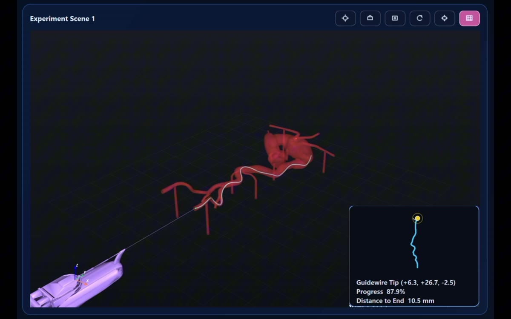
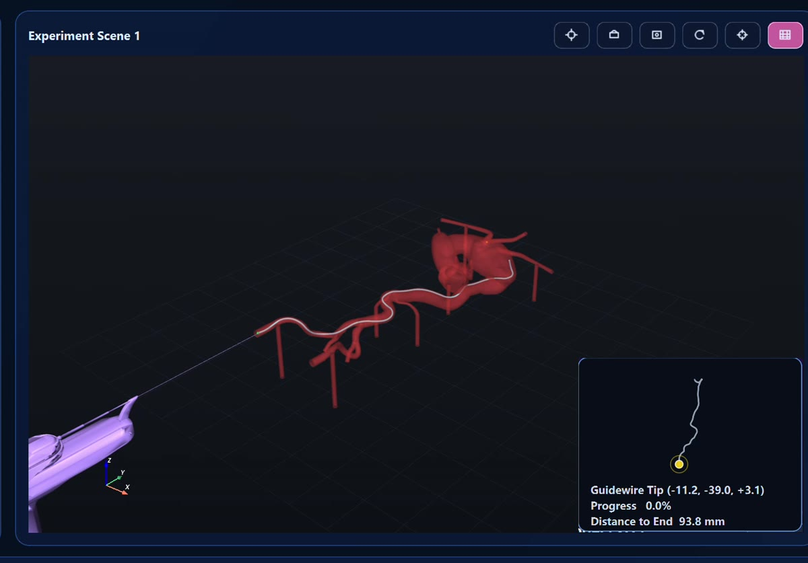

# ZMD_PY_RL-ENG: Vascular Guidewire Simulation and Reinforcement Learning

ZMD_PY_RL-ENG is a research prototype for three-dimensional vascular guidewire simulation and reinforcement learning. It combines a PyQt6 desktop workspace, PyVista/VTK rendering, MuJoCo-based guidewire motion, VMTK centerlines, and Stable-Baselines3 training and inference.



## Overview

The workflow is **vessel and robot models → centerline extraction → guidewire simulation → policy training and evaluation → visual replay**. The desktop application supports interactive route selection and manual guidewire control. Command-line tools support repeatable training, inference, and result export.

### Key features

- A multi-scene 3D workspace with vessel, robot, centerline, guidewire, local guidewire view, and route minimap.
- Two entry presets and three exit presets for single-route or six-route generalized training.
- Manual advancement, retraction, and rotation, plus MuJoCo guidewire simulation with optional vessel collision checks.
- PPO, SAC, TD3, DDPG, and DQN training and inference through Stable-Baselines3.
- Configurable reward terms and segmented advancement-speed profiles for training and inference.
- Training diagnostics, evaluation curves, and CSV export for inference runs.

### Screenshots

| Training workspace | Inference replay |
| --- | --- |
|  |  |

The screenshots are from recorded desktop demonstrations. The video files and trained checkpoints are not included in this source repository.

## Project structure

```text
ZMD_PY_RL-ENG/
├── main.py                 # Desktop application entry point
├── assets/models/          # Vessel and robot STL models
├── config/                 # Application, physics, and RL settings
├── projects/               # Project YAML files; generated cache is ignored
├── zmd/
│   ├── app/                # Application and navigation
│   ├── ui/                 # Pages, panels, and widgets
│   ├── centerline/         # Centerline data and route handling
│   ├── scene/              # Scene configuration and management
│   ├── rendering/          # 3D rendering
│   ├── simulation/         # Physics and guidewire backends
│   ├── rl/                 # RL environments, trainers, and inference
│   └── experiments/        # Experiment records and metrics
├── scripts/               # Preprocessing, training, inference, and plots
└── tests/                 # Automated checks
```

## Setup

The current development environment uses **Windows and Python 3.12**. Dependencies are listed in [requirements.txt](requirements.txt). VMTK is used from a separate Python environment for centerline preprocessing and is not installed by `requirements.txt`.

```powershell
conda create -n zmd_pyqt python=3.12
conda activate zmd_pyqt
python -m pip install -r requirements.txt
```

The included STL models are referenced by [projects/default_project.yaml](projects/default_project.yaml). This repository also includes the precomputed centerline at `projects/cache/VascuModel_centerline.vtp`, which is required for training and inference, and the optional collision mesh at `projects/cache/VascuModel_collision.stl`. If you change the vessel model, regenerate the centerline with VMTK:

```powershell
$env:ZMD_VMTK_PYTHON = "C:\path\to\vmtk-env\python.exe"
python scripts/vmtk_extract_centerline.py
```

Set `ZMD_VMTK_PYTHON` to the Python executable in an environment that has VMTK installed. The two supplied files under `projects/cache/` are tracked; intermediate preprocessing files, training checkpoints, logs, and other outputs remain local. See the [VMTK centerline extraction script](scripts/vmtk_extract_centerline.py) for implementation details.

For the optional MuJoCo vessel-hull collision mode on Windows, use a checkout path containing only ASCII characters. The current mesh loader cannot open hull STL files when a parent directory contains Chinese characters.

Launch the desktop application from the repository root:

```powershell
python main.py
```

## Training and inference

In the desktop workspace, open **Reinforcement Learning**, select an algorithm and route, and use **Start** to train or **Load Checkpoint** and **Run Model** to replay a policy. The interface labels entry and exit routes starting at 1; the command-line indices below start at 0.

Train a PPO policy for Entry 1 → Exit 3:

```powershell
python scripts/train_rl_cli.py --algo PPO --entry 0 --exit 2 --episodes 500 --max-steps 1200
```

Train across all six entry/exit routes:

```powershell
python scripts/train_rl_cli.py --algo PPO --generalize --episodes 500 --max-steps 1200
```

Run inference with a trained checkpoint and export a rollout CSV:

```powershell
python scripts/infer_rl_cli.py projects/cache/rl/MODEL.zip --algo PPO --entry 0 --exit 2 --output projects/cache/rollout.csv
```

Replace `MODEL.zip` with a checkpoint produced by training. The centerline is already included; trained checkpoints are not. Use `--help` on either script for additional route, reward, speed, and output options.

## Data and reproducibility

- Source code, configuration, and the two STL models under `assets/models/` are part of the repository.
- The supplied centerline and vessel collision mesh under `projects/cache/` are tracked. Model checkpoints, logs, CSV results, other cache files, and temporary outputs remain local under `projects/cache/` or `outputs/`.
- The demonstration videos are stored outside this repository. Public video links can be added here after hosting them separately.
- Model behavior depends on the route, reward settings, speed profile, seed, and checkpoint. Save these settings with each experiment when comparing results.

## Support

Questions and bug reports can be filed in [GitHub Issues](https://github.com/Soong1213/ZMD_PY_RL-ENG/issues).
